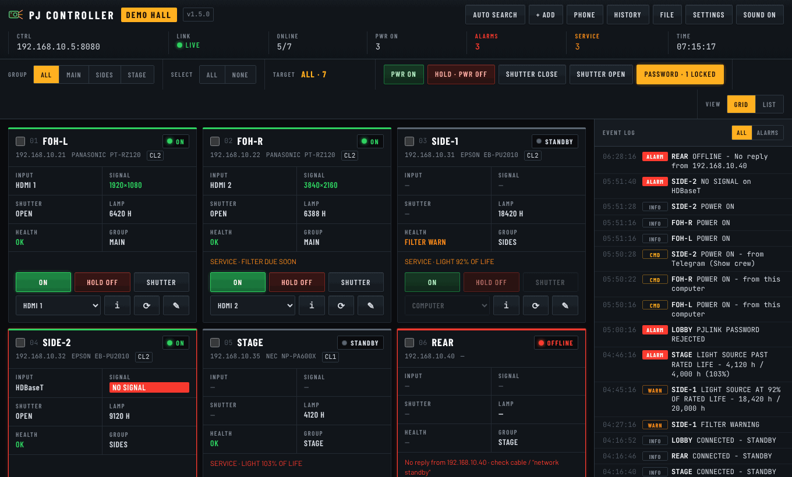
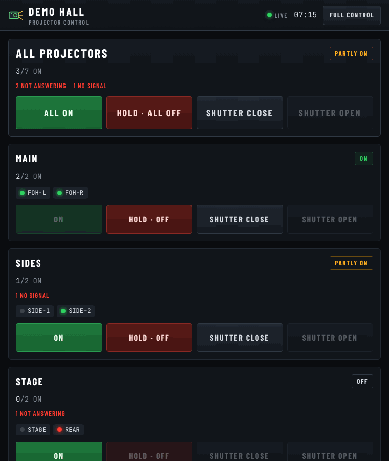
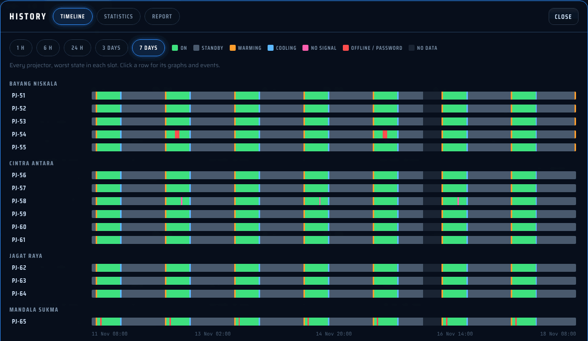

# PJ Controller

Switch every projector on and off from one screen. PJ Controller talks to projectors over the network with **PJLink**, the standard most projector brands support (Panasonic, Epson, NEC, Sony, Christie, Barco and others). It works over HDBaseT too.



- **Power and shutter** for one projector, a group, or all of them. Inputs, too.
- **Live status:** on, standby, warming, cooling, offline, NO SIGNAL, lamp hours and health.
- **Safe:** OFF needs a hold, a projector still warming up is protected, and ON waits until cooling is done.
- **From any phone or tablet** on the same network, or from another site over VPN.
- **A simple client page** with only ALL and group buttons, behind its own PIN.
- **Telegram:** control from your team's group and get alarms there.
- **History and reports:** a timeline, statistics, and a one-page post-show report (PDF or Telegram).
- **Works without internet.** Internet is only needed for updates and Telegram.

**[⬇ Download the latest version](https://github.com/lzy9803/PJ-Controller-releases/releases/latest)** · [What's new](https://github.com/lzy9803/PJ-Controller-releases/releases)

---

## 1. Before you start: projector settings

On every projector (or on the HDBaseT receiver's network menu):

1. **PJLink: ON.** Some brands hide it under *Network → Control* or *Protocol*.
2. **Standby mode: "Network standby"** (or "Normal"), **not "Eco"**. In Eco standby the network switches off, and the projector shows OFFLINE until someone turns it on by hand.
3. **Static IP address** (or a fixed DHCP reservation).
4. Note the **PJLink password**, if one is set. Panasonic and Epson often have one by default.

The computer or Raspberry Pi running PJ Controller must be on the same network as the projectors, or be able to reach them.

## 2. Install

### Windows

Download from the [latest release](https://github.com/lzy9803/PJ-Controller-releases/releases/latest):

| File | What it does |
|---|---|
| `PJ-Controller-Setup-x.y.z.exe` (recommended) | Double-click to install. It opens straight away and **updates itself**. |
| `PJ-Controller-x.y.z-portable.exe` | Runs without installing, e.g. from a USB stick. |

If Windows says **"Windows protected your PC"**, click **More info → Run anyway**.

### Raspberry Pi (runs 24/7)

On the Pi, with internet, run:

```bash
curl -fsSL https://github.com/lzy9803/PJ-Controller-releases/releases/latest/download/install-pi.sh | sudo bash
```

It starts by itself on boot. Open `http://<pi-address>:8080` from any computer, phone or tablet. The same command also updates it, or press **SETTINGS → UPDATE** on screen.

## 3. First steps

1. Press **AUTO SEARCH**, choose your network, then **START**. Tick the projectors found and press **ADD SELECTED**. You can also add one by IP with **+ ADD**.
2. Give projectors a **group** (e.g. MAIN, SIDES) to switch them together.
3. If projectors show **AUTH FAIL**, press **PASSWORD** and enter their PJLink password.
4. **PWR ON** / **HOLD · PWR OFF** act on the **TARGET**: the ticked projectors, the chosen group, or all.

## 4. Phones, tablets and other sites

- **PHONE** shows a QR code. Scan it on a phone on the same network.
- **Set a login PIN** (SETTINGS) before anyone connects from outside the room.
- **Another site:** connect over a VPN such as Tailscale, then use the *Site* menu in the desktop app. **Never open port 8080 to the internet.**

## 5. Client page



A panel for your client at `http://<controller>:8080/simple`, kept apart from the engineer view.

- **Group tiles:** tap the left side to switch a group on, hold it to switch off, and tap the right side to close or open the shutter.
- **ALL ON / ALL OFF**, **BLACKOUT** (every shutter closed) and **PANEL LOCK** (ignores taps until held for 2 seconds).
- **No way to the engineer view.** On a screen in the room, press **CLIENT VIEW** in the dock. With a login PIN, that screen then needs the engineer PIN to return.
- **Client PIN** (SETTINGS → CLIENT PAGE): lets other devices open the panel only.
- **Every press is logged** with where it came from.

## 6. History and post-show report



Press **HISTORY**:

- **Timeline:** a bar for every projector, 1 hour to 7 days. Click one for its graphs.
- **Statistics:** availability, hours on, incidents and alarms per day. Download as CSV.
- **Report:** a one-page report for the client, for a day or just the show hours. Open and print it, download the PDF, or send it to Telegram.

## 7. Telegram

1. In Telegram, message **@BotFather**, send `/newbot` and copy the token.
2. In PJ Controller open **SETTINGS → TELEGRAM**, paste the token, and press **CONNECT**.
3. Add the bot to your team group, or send it `/pj`. Check the code, then press **APPROVE**.
4. In the group, use `/control` for buttons, `/on`, `/off`, `/shutter`, `/pj status` and `/pj help`.

## 8. Updates

- **Windows (installed version):** it downloads updates by itself and asks *Restart now / Later*. *Later* installs when you next close the app, so it never restarts mid-show.
- **Raspberry Pi:** use **SETTINGS → UPDATE**. It can also update itself at night, but only when every projector is off.
- **Projectors are never switched on or off by an update.**

## 9. Troubleshooting

| You see | Try this |
|---|---|
| **OFFLINE** | Check the cable or HDBaseT link, and that standby mode is *Network standby* (not Eco). Ping the projector's IP. |
| **AUTH FAIL** | Wrong or missing PJLink password. Use **PASSWORD** in the command strip. |
| **NO SIGNAL** | The projector is on but no picture is coming in. Check the source and the selected input. |
| AUTO SEARCH finds nothing | Is this computer on the projectors' network? Is PJLink on? Try the exact IP range. |
| The phone can't open the page | The phone must be on the same network or VPN. Use the address shown under **PHONE**. |
| **Signal: N/A · CL1** | An older PJLink Class 1 projector. Power and shutter work, but it can't report the signal. |

## Need help?

**Contact your technician.**
